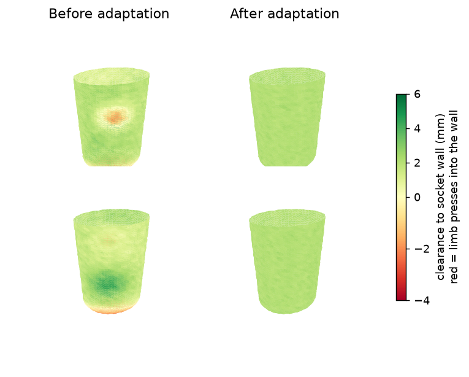

# prosthesis-socket-fit

Aligns a scanned residual-limb surface to a prosthetic socket, measures the fit as a per-vertex clearance map, and adapts the socket wall to a target clearance. Python, numpy and scipy only.

I took a course where a 3D model of a prosthesis to be printed was overlapped with the scanned limb of a patient in Meshmixer, by hand, to check and adjust the fit. This repo reproduces that flow as a script. It is a new, independent rebuild: it uses **synthetic meshes only**, with no patient scans and none of the course material. It is an educational approximation, not a medical device and not validated for clinical use.



Limb surface colored by its clearance to the socket wall, seen from two sides. Before: the limb presses into the wall at the prominence (red) and the socket is loose elsewhere (green). After: the wall sits about 2 mm off the limb everywhere.

## Pipeline

1. **Synthetic inputs** (`socketfit/synthetic.py`): a tapered, rounded, slightly elliptical limb with a bony prominence and scanner noise, placed in an arbitrary pose; and a socket designed from the nominal limb plus 2 mm, with a deliberately loose region.
2. **Alignment** (`socketfit/align.py`): rigid ICP (KD-tree nearest points, Kabsch/SVD). The initial pose comes from the principal axes of both meshes; the sign ambiguity is solved by trying the four proper axis combinations and keeping the lowest residual.
3. **Fit measurement** (`socketfit/fit.py`): signed distance from every limb vertex to the socket wall, along the wall normal. Negative means interference.
4. **Socket adaptation** (`adapt_socket`): measure the gap at each socket vertex, smooth the required displacement over the mesh so the wall stays fair, move vertices along their normals, repeat three times, then a one-sided pass that pushes out anything still tighter than the target.
5. **Output**: ASCII STL files (aligned limb, original socket, adapted socket) and the figure above.

## Result (synthetic, target 2 mm)

```
before: clearance min -2.81 / mean 1.43 / max 4.80 mm, 11.1% of surface in interference, 75.2% within the target band
after:  clearance min 1.47 / mean 2.07 / max 2.96 mm, 0.0% of surface in interference, 100.0% within the target band
```

The target band is the target plus or minus 1 mm. The alignment recovers the applied rotation to about 0.05 degrees.

## Run it

```
python -m venv .venv
.venv/Scripts/pip install -r requirements.txt      # Linux/macOS: .venv/bin/pip
.venv/Scripts/python -m pytest
.venv/Scripts/python -m socketfit.demo             # writes out/*.stl and docs/before_after.png
```

With your own ASCII STL files, in millimetres (the limb is a scanned surface, the socket is its inner surface):

```
python -m socketfit.cli limb.stl socket.stl --target 2.0 --out socket_adapted.stl
```

## Limits

- Synthetic geometry. Real scans have holes, noise and soft-tissue deformation that this does not model.
- The fit is a purely geometric clearance. It ignores tissue compliance, load and pressure tolerance, so it cannot say whether a socket is comfortable or safe.
- Position along the limb axis is only weakly constrained on a smooth tapered shape: in the synthetic case the aligned limb sits about 3 mm off its true axial position, while the rotation is recovered almost exactly.
- Distances use nearest samples (vertices and triangle centroids), so values are approximate on very coarse meshes. After adaptation the minimum clearance is 1.47 mm for a 2 mm target for that reason and because of the smoothing.
- ASCII STL only, no binary STL, and no hole-filling or remeshing.
- The adaptation moves the whole wall to one target clearance. A real design relieves bony areas and keeps contact for suspension in others, so a single target is a simplification.

MIT license.
